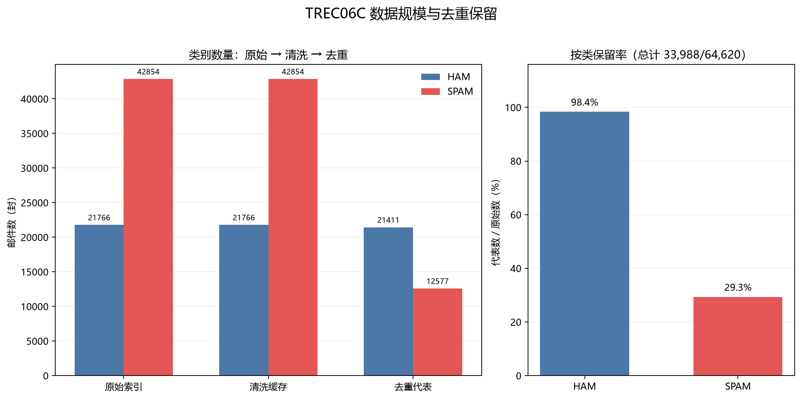
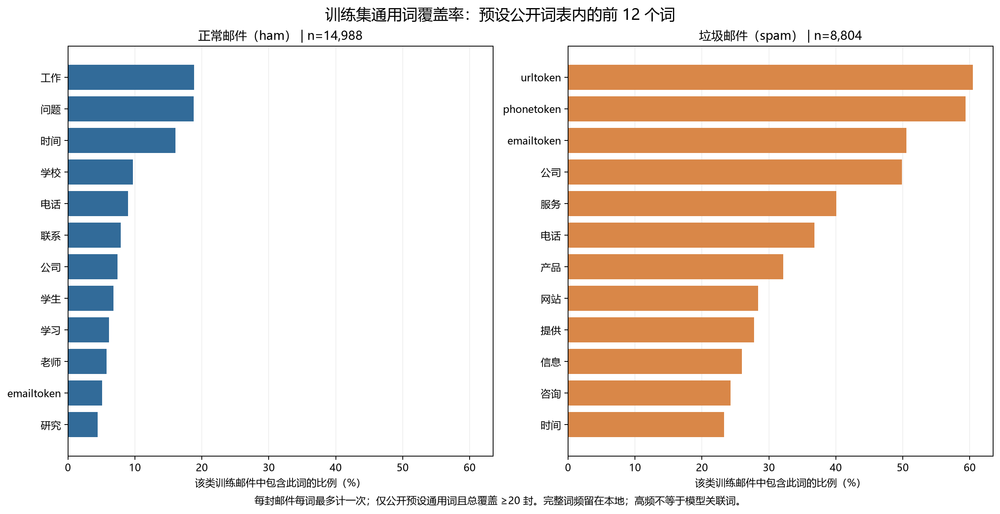
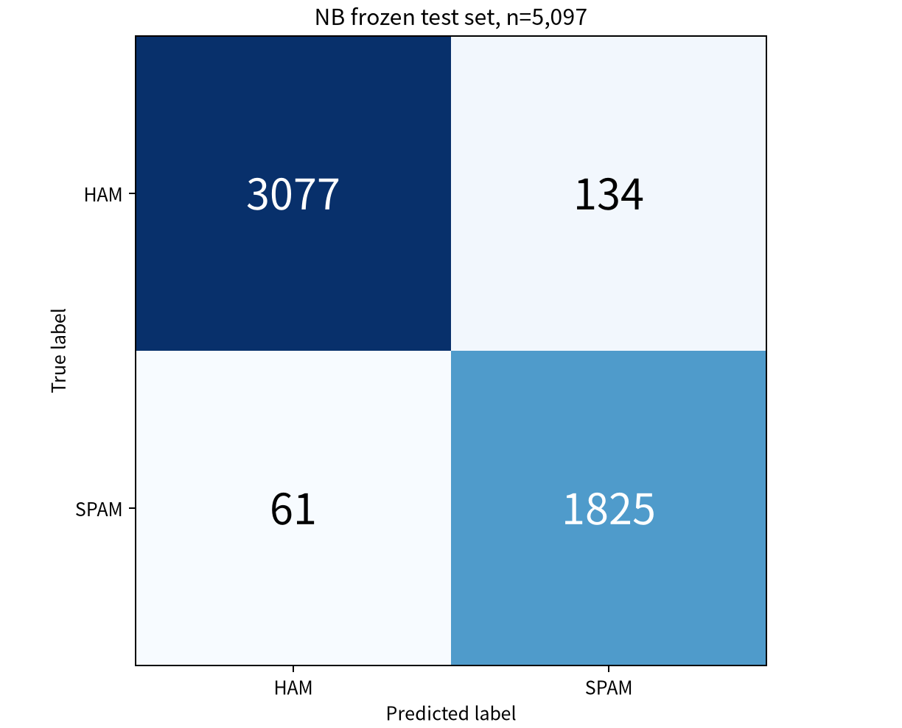
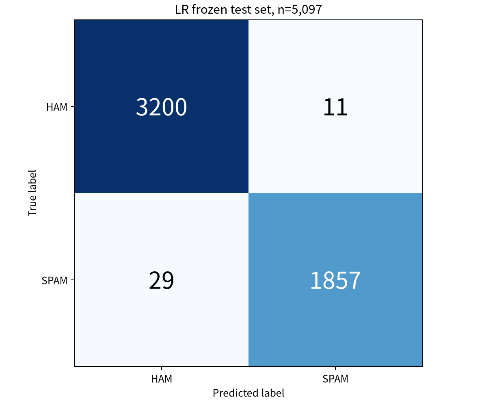
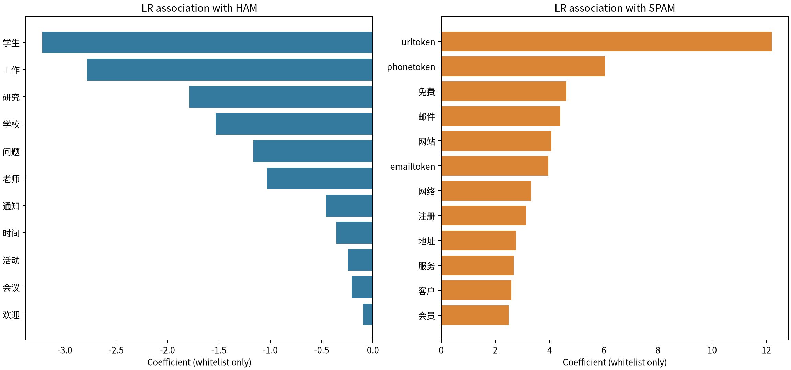

# 中文垃圾邮件分类项目报告

教师原模板版，真实实验完成，成员信息与实际贡献待本人确认。

## 目录

## 摘要

本项目处理课程提供的 TREC 2006 中文邮件语料，研究邮件解析、编码恢复、HTML 清洗与文本分类。64,620 封邮件经清洗和精确去重后保留 33,988 封代表，按内容分组冻结训练、验证、测试集合。采用 jieba 分词和训练侧 50,000 维 TF-IDF，比较多数类、朴素贝叶斯与逻辑回归。通过验证集选参及 HTML 对照后，锁定 LR C=2 和去除 HTML 标签的可读文本。在 5,097 封最终测试邮件上，LR 准确率为 99.22%，macro-F1 为 99.16%，正常邮件误报 11 封，垃圾邮件漏报 29 封。结果支持其在本历史语料上优于本轮 NB 基线，但不能直接外推实际收件箱。结合真实错分的 AI 辅助语义复核，报告提出复核队列和数据质量改进建议。

关键词：中文垃圾邮件；邮件解析；TF-IDF；朴素贝叶斯；逻辑回归

## 1 引言

垃圾邮件识别需要同时控制误拦正常邮件和漏掉垃圾邮件。本项目可靠提取邮件文本，公平比较两种分类方法，检验 HTML 清洗影响，并解释真实错误与关键词。除准确率外，重点关注正常邮件误报率与垃圾邮件召回率。

固定开发样本用于解析调试；训练集学习词表、IDF 与模型参数；验证集用于有限选参和清洗对照；锁定后才计算最终测试成绩。每阶段保存来源指纹与检查记录。

## 2 数据介绍

| 范围 | 正常邮件 | 垃圾邮件 | 合计 |
|---|---|---|---|
| 主索引 | 21,766 | 42,854 | 64,620 |
| 技术可用 | 21,766 | 42,854 | 64,620 |
| 去重代表 | 21,411 | 12,577 | 33,988 |

数据由课程附件提供，入口为 trec06c/full/index。每行给出 ham 或 spam 标签及邮件相对路径，标签映射为 ham=0、spam=1。delay/index 涉及同一批邮件，不能视作新增样本或独立测试集。原始邮件为 RFC822 格式，正文多含 HTML，字符编码以 GBK/GB2312 为主。

| 字段 | 用途 |
|---|---|
| mail_id | 由相对路径确定的稳定 ID，仅用于对账 |
| label / label_name | 二元真值和类别名称，不进入特征 |
| subject_clean / body_clean | 规范化后的主题和正文 |
| text_clean / HTML 对照 | 去标签文本与保留 HTML 的对照表示 |
| parse_status / 质量标记 | 解析状态、HTML 与编码警告等质量信息 |

先固定 ham、spam 各 200 封开发样本用于解析器调试；正式分析采用全量语料。原始邮件、逐封文本、完整词表、模型文件和预测明细只保存在本地忽略目录。公开仓库保留代码、聚合结果、固定划分元数据和阶段说明。

## 3 数据清洗与预处理

### 3.1 编码与结构恢复

二进制读取邮件后解析头部与 MIME。先解 base64、quoted-printable 等传输编码，再按声明字符集与明确候选回退解码。multipart/alternative 选择一个有效正文表示，避免纯文本和 HTML 重复拼接；related 保留根内容，跳过二进制附件与转发的整封子邮件。损坏边界、回退动作和质量警告分别记录。

HTML 去掉 script/style 与标签，解码实体并保留可读文字和锚文本。随后进行 Unicode NFKC、英文小写、控制字符与空白清理，以及常见联系字段归一化。主题与正文分别清洗后组合。空主题或正文不填造内容，只有主题可用时保留并标记；不可恢复样本按规则进入隔离账目。

| 互斥解析状态 | 封数 | 解释 |
|---|---|---|
| ok | 29,891 | 常规处理可用 |
| recovered | 33,307 | 记录回退或结构恢复 |
| subject_only | 1,422 | 仅主题可用 |
| 隔离或错误 | 0 | 本批数据的技术结果 |

“技术可用”只表示获得了可供后续处理的文本，不保证语义完全正确。零替换字符也不能证明不存在乱码。异常长度只作诊断，不仅凭长度删掉邮件。常见联系字段掩码并非全面匿名化，因此真实正文不公开。

### 3.2 清洗机制说明

例如人工构造的 HTML“&lt;b&gt;会议通知&lt;/b&gt;&lt;script&gt;代码&lt;/script&gt;”应只保留“会议通知”；同一邮件的纯文本与 HTML 替代正文只选一份。这些示例用于解释规则，不充当真实误分类案例。真实清洗影响通过第 6.1 节固定条件实验衡量。

本轮附件恢复后，主索引、64,620 封清洗缓存及清洗聚合记录与历史指纹一致。开发和全量行级检查均通过。代码没有利用最终测试的分类成绩修改解析规则。

### 3.3 去重与冻结数据划分

对同标签且规范化主题与正文完全相同的邮件保留一个确定代表，移除 30,632 封重复记录。相同原始字节、最终文本、有效正文或 HTML 对照文本形成关联分组，整组划分，减少精确内容跨集合泄漏。开发样本触及的 372 个分组、1,738 封代表强制进入训练侧。

| 集合 | 正常邮件 | 垃圾邮件 | 合计 |
|---|---|---|---|
| 训练 | 14,988 | 8,804 | 23,792 |
| 验证 | 3,212 | 1,887 | 5,099 |
| 测试 | 3,211 | 1,886 | 5,097 |

种子为 42，目标比例为 70%/15%/15%，受整组与开发约束影响实际计数略有差异。三套冻结 CSV 与原版本字节一致；ID、标签、精确内容分组和去重账本校验通过。该规则不能穷尽近重复模板。

## 4 探索性分析

图 1  原始邮件、清洗与去重后的类别规模



spam 占比由原始约 66.32% 降为去重代表中的 37.00%。ham 保留率约 98.37%，spam 约 29.35%，说明这批语料中垃圾邮件精确重复更多。评估对象是不同规范化文本，不能把去重后的类别比例当成实际邮件流分布。

### 4.1 长度与高频词

训练侧 ham、spam 文本长度中位数分别为 302、499 字符；所选正文含 HTML 的比例约为 4.18%、33.88%。这些差异用于描述数据与解释工程负担，不是按测试效果筛选特征的依据。

图 2  训练侧预设通用词表内的高覆盖词



每封邮件对每个词最多计一次，覆盖率等于包含该词的该类训练邮件数除以该类总数。“工作”“问题”等词体现日常沟通，“公司”“服务”及联系字段占位符也常见于商业邮件。公开图限定于预设通用词表且总覆盖不少于 20 封，不是完整词表的全局排名；高频不直接代表分类判别力。

## 5 特征工程与模型构建

jieba 采用精确模式、HMM=False，使用固定的 57 项停用词。TF-IDF 只在训练集学习词表和 IDF，min_df=2、max_features=50,000，采用次线性词频、平滑 IDF、L2 归一化和 float64 稀疏 CSR 矩阵。验证与测试仅转换，转换前后词表与 IDF 指纹不变。

TF-IDF 降低广泛出现的常见词权重，并限制单封邮件中重复词频的增长。ID、标签、文件路径、路由头和现成垃圾评分均不进入模型。空向量、矩阵行序和标签都经过核验。

### 5.1 模型与验证选择

多数类由训练集确定，为所有邮件输出正常类。MultinomialNB 用平滑的类别词分布分类，比较 alpha=0.1、0.5、1；LogisticRegression 联合学习词权重，比较 C=0.5、1、2，固定 liblinear、max_iter=2000、random_state=42，并检查收敛。两种方法使用相同训练样本、标签与特征规则。

预设选择顺序为 macro-F1 降序、正常邮件误报率升序、spam 召回率降序，再按候选名稳定打破平局。使用未四舍五入的数值，排除多数类及未收敛候选。不调阈值，也不在选择后用训练加验证重新拟合。

| 验证模型 | 准确率 | 精确率 | 召回率 | macro-F1 | 误报率 |
|---|---|---|---|---|---|
| 多数类 | 62.99% | 0.00% | 0.00% | 38.65% | 0.00% |
| NB α=1 | 95.23% | 92.90% | 94.33% | 94.91% | 4.23% |
| LR C=1 | 98.53% | 99.08% | 96.93% | 98.42% | 0.53% |
| NB α=0.1 | 95.88% | 93.47% | 95.55% | 95.60% | 3.92% |
| NB α=0.5 | 95.57% | 93.05% | 95.12% | 95.27% | 4.17% |
| LR C=0.5 | 98.14% | 98.70% | 96.24% | 97.99% | 0.75% |
| LR C=2 | 98.86% | 99.41% | 97.51% | 98.78% | 0.34% |

上表只包含 5,099 封验证邮件的结果，精确率与召回率以 spam 为正类。Linux 复现中两个非最优 NB 配置的误报各差 1 封；最佳 NB 与 LR 指标不变，分别选 alpha=0.1 和 C=2。LR C=2 验证误报 11 封、漏报 47 封，按预设规则进入清洗对照。

### 5.2 指标定义

FP 是误拦正常邮件，FN 是漏掉垃圾邮件。准确率为 (TP+TN)/N；spam 精确率为 TP/(TP+FP)，召回率为 TP/(TP+FN)；F1 为精确率与召回率的调和平均，macro-F1 为 ham 与 spam 两类 F1 的均值；正常邮件误报率为 FP/(TN+FP)。分母为零时按预定规则记零。

多数类验证准确率虽达 62.99%，却漏掉全部 1,887 封垃圾邮件，说明只看准确率会掩盖失败。最终泛化评估须使用锁定后的测试集，不能把验证选参成绩当作最终成绩。

## 6 评估与结果解释

### 6.1 HTML 清洗影响对照

| LR C=2 输入 | 准确率 | macro-F1 | 误报率 |
|---|---|---|---|
| 去标签 | 98.86% | 98.78% | 0.34% |
| 保留 HTML | 98.84% | 98.75% | 0.34% |

固定训练/验证 ID、标签、分词和 LR C=2，仅改变 HTML 表示，各自在训练集拟合 TF-IDF，独立核验通过。去标签 macro-F1 高 0.021 个百分点，按预设规则选去除 HTML 标签的可读文本。实际改变输入的训练/验证样本仅 156/36 封，净少漏报 1 封，不能宣称普遍或显著提升。

### 6.2 锁定后的最终测试

| 测试模型 | 准确率 | 精确率 | 召回率 | macro-F1 | 误报率 |
|---|---|---|---|---|---|
| 多数类 | 63.00% | 0.00% | 0.00% | 38.65% | 0.00% |
| NB α=0.1 | 96.17% | 93.16% | 96.77% | 95.93% | 4.17% |
| LR C=2 | 99.22% | 99.41% | 98.46% | 99.16% | 0.34% |

测试前锁定方案、参数与来源，最终测试含正常 3,211 封、垃圾 1,886 封。LR 正常/垃圾类 F1 为 99.38%/98.93%，误报 11、漏报 29；NB 误报 134、漏报 61。独立重算与重载预测一致。

图 3  最终测试混淆矩阵，左 NB，右 LR。行是真实类别，列是预测类别。




### 6.3 易错样本与模型关联词

NB、LR 各按分数绝对值从高到低选择最多 15 个 FP 和 15 个 FN，不足则全部取出，共 56 个模型错误实例。正文只在本地阅读，公开内容为去除身份、联系方式和原句的语义概述。本轮完成 AI 辅助逐例核查；长邮件检查首、中、尾选段，学生全文人工签认仍待完成。置信度排序样本并非随机抽样，以下类别不能解释为全部错误的发生比例。

| 实例 | 语义观察 |
|---|---|
| LR-FP-01 | 正常标签的多企业岗位汇总含公司、销售和联系词，与商业推广词汇重叠。 |
| LR-FN-10 | 主题推广学车服务，正文以重复小说片段和图片标记为主，业务信息在文本中占比很低。 |
| LR-FN-06 | 仅有周末户外邀约主题，没有可用正文，短文本缺少足够的分类线索。 |
| NB-FN-09 | 用同事请假的私人聊天口吻引入生活消费网站与优惠信息，推广嵌在日常交流中。 |

误报中可见招聘与商业词重叠；漏报中可见短文本，以及故事或私人聊天包裹推广。它们是内容观察，尚未通过反事实实验验证为模型错因。相似主题、招聘模板与查分通知提示近重复仍可能残留；本次测试后不据此重调模型。

图 4  预设公开词表内的 LR 正负关联词



系数正值使线性得分更偏向 spam，负值更偏向 ham。权重反映训练分布下的条件关联，不证明因果关系，也不能把某个词等同于垃圾邮件。高频覆盖率和系数回答不同问题；两张词图都仅展示固定通用词表内的结果。

## 7 总结与结论

本项目完成原始邮件解析、精确去重、冻结划分、训练侧特征、两模型验证比较和清洗对照。锁定后的 LR C=2 在最终测试中达到 99.22% 准确率与 99.16% macro-F1，在本轮设置下优于 NB。正常邮件仍有 11 封被误拦，不能据高准确率直接启用永久删除。

建议优先将模型输出用于可恢复的垃圾箱或复核队列，为误拦保留申诉和恢复入口；对短文本、仅主题邮件及内容标签可能不一致的实例进行复核。若未来改阈值、增加字符特征或改进解析器，应重新设计训练和验证方案，并使用新的未见测试集，不能继续利用本次测试挑选改动。

局限包括语料年代较早、精确去重后类别比例变化、可能残留近重复模板、编码恢复不保证语义无误，以及有限验证选参。当前结果不代表实际收件箱的错误率，也未检验跨时间、跨来源稳定性。AI 辅助错误解释是待成员确认的观察，不是对原标签的重新标注。

## 8 小组成员分工与个人承担

| 成员姓名 | 学号 | 承担章节或模块 | 具体工作与提交 |
|---|---|---|---|
| 待本人填写 | 待本人填写 | 按实际工作填写 | 对应真实 Git 提交 |
| 待本人填写 | 待本人填写 | 按实际工作填写 | 对应真实 Git 提交 |
| 待本人填写 | 待本人填写 | 按实际工作填写 | 对应真实 Git 提交 |

成员一：待本人说明负责部分的分析思路、方法步骤、遇到的问题、解决方式与对应提交。

成员二：待本人说明负责部分的分析思路、方法步骤、遇到的问题、解决方式与对应提交。

成员三：待本人说明负责部分的分析思路、方法步骤、遇到的问题、解决方式与对应提交。

本轮续作使用 AI 辅助编程、实验核验与材料整理；不把辅助提交冒充三位学生的个人贡献。组号、组长、学院、专业与成员信息仍需确认。提交课程终稿前，成员应完成真实错分复核、复现或讲解，并据实际记录填写本节。

## 9 附录

### 9.1 仓库与运行方法

仓库：https://github.com/25121596/Python-teamwork
续作分支：complete-project-stages。每个实际阶段配有 docs/stages Markdown 和独立 Git 提交。当前 GitHub 应用写入返回 403，续作尚未上传成功；交付 Git bundle 保留完整本地历史。

本轮使用 Python 3.12.14，依赖见 requirements.txt；原语料放在仓库外，以 config.local.json 配置。新机器按 README 从测试前版本 b4a5299 建立独立 worktree，先完成索引、清洗、冻结划分及模型训练验收，再按下列顺序运行；每步失败即停止。如实报告跨平台差异，不覆盖已锁定发布证据。

```bash
python scripts/compare_cleaning.py
python scripts/check_ablation.py
python scripts/evaluate_final.py
python scripts/check_final_results.py
```

### 9.2 核心代码摘录

节选自 scripts/evaluate_final.py：先验证锁，再读取测试；省略重复运行检查与访问记录写入。

```python
lock = verify_lock(root)
lock_sha = file_sha256(root / "artifacts/metrics/final_lock.json")
require_ablation_validation(root, lock_sha)
rows = read_test_rows(root, lock)
records = read_records(root, {"test": rows},
    lock["cleaning_cache_sha256"])["test"]
```

### 9.3 证据与提交事项

原始要求与空白模板：docs/references/；解析、划分和模型核验：artifacts/audit/；验证、对照和最终测试表：artifacts/metrics/；公开图：artifacts/figures/。正文报告不包含真实邮件全文、逐封预测和完整词表。

PPT 与约 5 分钟真实讲解视频需在 2026 年 10 月 31 日以前提交学习通，命名为“组号_6_组长姓名.pptx/.mp4”。Word 在 11 月 8 日晚 12 点前提交学习通，纸质版交未来技术学院 418。视频录制、成员信息及课程平台提交仍由小组完成。
