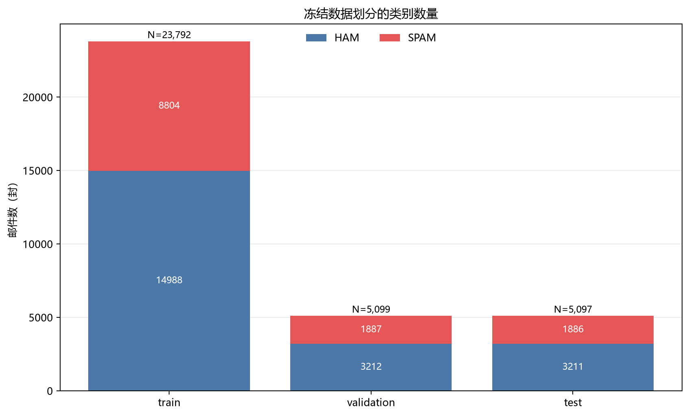
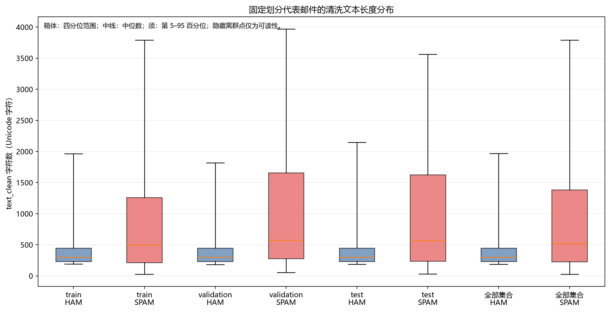
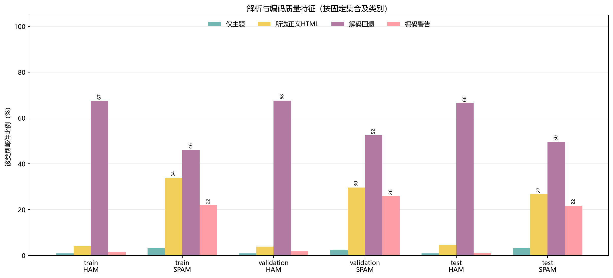

# 第五阶段 探索分析与文本特征

日期：2026 年 10 月 14 日。

已完成五张可用于报告的图、固定 jieba 分词规则，以及只在训练集拟合的 50,000 维 TF-IDF 管线。训练/验证/测试矩阵分别有 23,792 / 5,099 / 5,097 行，全部为 float64 CSR 稀疏矩阵，无空特征向量。词表、IDF、完整词频和矩阵仅保存在本地；公开内容为代码、固定规则、人工示例、图表和聚合验证。

本阶段没有训练分类器，也没有计算准确率或 F1。正式模型比较留到第六步，最终测试效果留到第八步。

**代码、配置与产物**

| 文件 | 作用与范围 |
|---|---|
| `src/spam_classifier/dataset.py` | 核对前阶段缓存、源码、固定清单与账本指纹，按 ID 对齐文本及集合 |
| `src/spam_classifier/text_features.py` | 固定 jieba tokenizer 和单步 TF-IDF Pipeline，后续可接分类器 |
| `config/stopwords_zh.txt` | 57 个预先固定的通用停用词，不从验证/测试推导 |
| `config/public_terms_zh.txt` | 53 个预先固定的公开通用词/占位符，仅控制公开词图，不限制模型词表 |
| `scripts/analyze_corpus.py` | 类别、长度、质量及固定划分的描述性 EDA 与四图 |
| `scripts/build_features.py` | 训练侧拟合、两套 heldout 转换、训练词覆盖统计和第五张图 |
| `scripts/check_features.py` | 新进程加载管线、训练 DF/IDF 重算、矩阵/行序/配置/指纹核验 |
| `tests/test_text_features.py`、`test_dataset.py`、`test_feature_audit.py` | 本阶段新增 14 项人工语料与回归测试 |
| `artifacts/audit/eda_summary.json` | 描述性统计、图路径、来源及 EDA 源码指纹 |
| `artifacts/audit/feature_summary.json` | 特征配置、词典指纹、矩阵统计、白名单词覆盖率与本地产物指纹 |
| `artifacts/audit/feature_validation.json` | 独立特征验收结果 |
| `artifacts/audit/stage05_validation.json` | 测试、隐私、图表和提交前检查的综合证据 |
| `artifacts/processed/features/*.npz`、`row_order.json`、`training_word_coverage.csv` | 三套矩阵、行 ID/标签顺序及完整词覆盖表，仅本地保存 |
| `artifacts/models/tfidf_pipeline.joblib` | 可重载的已拟合特征管线，仅本地保存 |
| `docs/分词与特征说明.md` | 三个人工示例、TF-IDF 计算口径及后续使用边界 |

依赖沿用既有锁定版本，没有新增安装包。第五步公开 JSON 与静态词表使用 LF 换行，避免 Windows Git 检出改变字节或规则指纹。

**复现顺序**

在已完成前四阶段、保留本地缓存与去重账本的仓库根目录执行：

```powershell
.\.venv\Scripts\python.exe scripts\analyze_corpus.py
.\.venv\Scripts\python.exe scripts\build_features.py
.\.venv\Scripts\python.exe scripts\check_features.py
.\.venv\Scripts\python.exe -m unittest discover -s tests -v
```

新电脑先依 README 配置外部语料并依次完成前四阶段，重建被忽略的缓存和账本，再运行上述命令。加载器验证冻结 CSV、完整清洗缓存、ID/标签/集合以及上游源码指纹，不按当前文件行序猜测文本与标签的对应。

`feature_summary.passed` 表示特征构建完成；阶段验收以 `feature_validation.passed` 和综合阶段证据为准。构建成功返回 0、致命错误返回 2；独立验收失败返回 1，配置/访问等错误为 2。异常时旧产物可能仍存在，不能仅凭文件存在宣称本轮成功。

独立检查通过新进程实际加载 joblib，运行入口会把本仓库 `src` 加入模块路径。手动加载也须使用相同模块路径和固定依赖，并核对配置、源码与词典指纹；不能把旧管线当作新规则的结果。

**描述性发现与解释**

全量清洗仍有 64,620 封可用邮件，去重后为 33,988 封。ham 保留率 98.37%、spam 保留率 29.35%；垃圾邮件占比由 66.32% 降为 37.00%，说明相同规范化内容的垃圾副本更多。多数类基线必须从当前训练集确定。


固定划分没有变化，仍为 train 23,792、validation 5,099、test 5,097；各集合 spam 比例约为 37%。



| 训练集统计 | ham | spam |
|---|---:|---:|
| 清洗文本长度 P50（Unicode 字符） | 302 | 499 |
| 长度 P95 | 1,966 | 3,790 |
| 长度最大值 | 30,395 | 30,616 |
| 仅主题比例 | 0.89% | 3.08% |
| 所选正文经 HTML 提取比例 | 4.18% | 33.88% |
| 解码回退比例 | 67.46% | 46.07% |
| 编码警告比例 | 1.59% | 21.96% |

垃圾邮件通常更长、所选正文中 HTML 更多；正常邮件的解码回退比例反而更高。回退表示使用了编码恢复策略，不等于语义错误率；这些质量指标也不是分类器预测效果，不能直接用某一个标记删除某类邮件。



长度图箱体为四分位范围，中线为中位数，须为第 5–95 百分位；为可读性隐藏了离群点，统计表仍保留最大值。JSON 的分位数使用 nearest-rank；图中箱线分位由 Matplotlib 按数据计算，可能有细微插值差别。



这些图含全语料及各固定集合的聚合描述，不用于挑选 token 规则、停用词、阈值或模型参数。各集合类别比例接近，并不保证长度/HTML 比例完全一致；本次未据此重新划分数据。

**固定分词与特征口径**

使用 jieba 0.42.1 默认词典，精确模式、`HMM=False`，记录词典文件 SHA256。NFKC、英文小写后应用固定停用词表；保留非停用词中文单字、纯数字和三种联系字段占位符，去掉单个英文字母、纯标点、规定字符范围外及超过 40 字符的 token。没有因邮件很短、数字很多或带质量警告而整封删除。

曾发现单字过滤会误丢“不、没、买、送”等中文词，已在成功拟合前修正并增加回归测试。首次构建在生成指纹时遇到 NumPy 整数索引不能直接 JSON 序列化，已转换为普通整数后重新拟合；以下统计均来自修正后的成功运行。

| TF-IDF 设置 | 固定值 |
|---|---|
| 输入 | 清洗主题＋正文 `text_clean`，不加入标签、路径、身份头、集合或质量标记 |
| n-gram | 词级一元组 `(1, 1)` |
| `min_df` / `max_df` | 2 / 1.0 |
| 最大特征 | 50,000，按训练语料词频截断 |
| TF | `1 + ln(tf)`，即 `sublinear_tf=True` |
| 平滑 IDF | `ln((1 + N_train)/(1 + df_train)) + 1` |
| 行归一化 | L2 |
| 存储 | CSR、float64，保持稀疏 |
| 拟合范围 | 仅 train；validation/test 只调用 transform |

训练分词共得到 122,865 种 token，其中 80,524 种至少出现于两封训练邮件；最终受 50,000 特征上限约束。普通数字仍参与本地特征，完整训练词覆盖表含 8,844 种数字 token，没有把这些具体数值词放进公开图或表。

| 集合 | 行数 × 列数 | 非零元素 | 非零率 | 空向量 |
|---|---:|---:|---:|---:|
| train | 23,792 × 50,000 | 3,664,007 | 0.3080% | 0 |
| validation | 5,099 × 50,000 | 807,971 | 0.3169% | 0 |
| test | 5,097 × 50,000 | 815,090 | 0.3198% | 0 |

训练 CSR 的数据、索引和指针共约 42.02 MiB，三套合计约 60.64 MiB；这是内存中的 CSR 数组大小，不是压缩 NPZ 文件大小。实际实现没有把真实矩阵转为稠密。

**训练侧词覆盖分析**

每封训练邮件对某词的文档频率最多贡献一次，以避免长邮件中反复出现同一个词支配结果。完整词覆盖表只保存在本地。公开图限制在统计前指定的 53 个通用词/占位符中，并要求合计至少覆盖 20 封训练邮件；每类选该范围内的前 12 个词。


| 预设公开词 | ham 训练覆盖率 | spam 训练覆盖率 |
|---|---:|---:|
| `urltoken` | 4.14% | 60.47% |
| `phonetoken` | 3.56% | 59.37% |
| `emailtoken` | 5.10% | 50.55% |
| 公司 | 7.41% | 49.85% |
| 工作 | 18.86% | 21.31% |
| 学校 | 9.70% | 2.61% |

占位符仍保留联系方式出现的信号，同时不公开具体联系方式。“工作”在正常邮件的公开高频列表中靠前，但垃圾邮件覆盖率也约为 21.31%；因此高频不等于特定类别的判据，更不等于模型系数或分类因果解释。模型关联词要等后续已训练模型再分析。

**实际验收与局限**

- 完整测试共 84 项：83 项通过、0 失败、0 错误、1 项跳过。新增 14 项全部执行通过；跳过项仍是旧索引测试的 Windows 符号链接权限限制。
- 独立特征脚本有 14 项全局检查，以及每个集合 7 项矩阵检查，全部通过；从训练文本重算文档频率、词频截断边界和平滑 IDF，核对未混入验证/测试统计。
- 新进程实际重载 joblib，对三套文本重新 transform，与保存矩阵一致；核对行 ID/标签顺序、CSR/float64、有限非负值、非空行 L2 范数和零向量计数。转换前后词表及 IDF 指纹保持不变。
- Luna 独立重算了按类别/集合的长度和质量聚合，与 JSON 逐字段一致；主代理完成五张图的视觉检查，中文字体、标签和范围正常。
- 验证/测试专有词不进入训练词表的行为由合成测试覆盖；另外核验 min_df、序列化往返、数据加载 checksum 拒收、中文单字保留和 NumPy 指纹类型兼容。
- 公开文件只含聚合、预设通用词和人工示例；正文、完整词表/词频、矩阵及模型受 Git 忽略规则保护。字典、静态规则、上游划分和源码指纹一起记录，后续变动必须重新核验对应产物。

jieba 的固定词典与 `HMM=False` 可能对新词、专名或历史乱码分词不足；截断会去掉部分低频词，数字词仍可能带语料特定模式。没有空向量只表示每封保留了至少一个词表内特征，不代表所有语义都被正确提取，也不代表分类成绩已知。

详细材料：[EDA 汇总](../../artifacts/audit/eda_summary.json)、[特征汇总](../../artifacts/audit/feature_summary.json)、[独立验收](../../artifacts/audit/feature_validation.json)、[综合阶段证据](../../artifacts/audit/stage05_validation.json)、[人工分词与 TF-IDF 说明](../分词与特征说明.md)。

**下一步**

第六步在同一划分和同一特征设置下比较训练多数类基线、MultinomialNB 与 LogisticRegression，只用验证集进行有限参数比较，记录收敛、耗时、macro-F1、spam 精确率/召回率及正常邮件误报。测试集最终分类评估继续留到第八步；第七步清洗对照另按同一训练 ID 拟合各自的词表/IDF。

参考：[jieba 官方说明](https://github.com/fxsjy/jieba)、[TfidfVectorizer 官方文档](https://scikit-learn.org/stable/modules/generated/sklearn.feature_extraction.text.TfidfVectorizer.html)、[数据泄漏与训练侧预处理](https://scikit-learn.org/stable/common_pitfalls.html#data-leakage)。

本阶段代码、静态规则、聚合结果、五张图和 Markdown 一起提交、推送并核验；准确提交编号以仓库历史为准。
