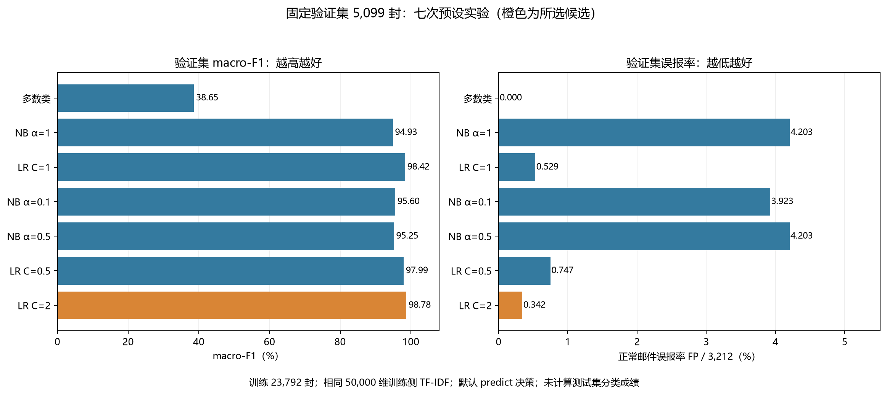

# 第六阶段：基线与两种模型比较

完成日期：2026 年 10 月 14 日。对应项目计划第 6 步。

本阶段完成多数类基线、MultinomialNB 和 LogisticRegression 的七次预设实验，使用固定验证集选择候选。当前候选为 **LR，C=2**；NB 类内最佳为 **alpha=0.1**。测试集分类成绩仍留到第 8 步，第 7 步将先做清洗影响对照。

## 1. 实验边界与输入

沿用 [第四阶段划分](04_去重与冻结数据划分.md) 和 [第五阶段特征](05_探索分析与文本特征.md)：

| 集合 | 正常 ham=0 | 垃圾 spam=1 | 本阶段用途 |
|---|---:|---:|---|
| 训练 | 14,988 | 8,804 | 23,792 封，拟合全部分类器 |
| 验证 | 3,212 | 1,887 | 5,099 封，比较参数并选候选 |
| 测试 | 3,211 | 1,886 | 5,097 封，本阶段不加载其矩阵或 CSV，不预测、不计算分类指标 |

三种方法使用完全相同的训练、验证代表和顺序。输入为既有 CSR float64 TF-IDF，50,000 列；词表和 IDF 仍只在训练集拟合。本阶段不重做去重、不换划分、不新增特征、不把验证样本并入训练。

`model_inputs.py` 先核对冻结来源、解析/特征源码指纹、依赖、独立特征验收、已消费文件 SHA256、CSV 标签与矩阵行序，再加载模型输入。不需要重新读取原始邮件或清洗正文；既有 `row_order.json` 包含三套集合元数据，本阶段只使用其中 train/validation 项。此前生成过测试特征和描述性 EDA，不等于已经评估测试分类效果。

## 2. 预先限定的候选与选择规则

| 方法 | 参数范围 | 固定设置 |
|---|---|---|
| 多数类 | 无 | `DummyClassifier(strategy="most_frequent")`，从训练标签确定多数类 ham |
| 朴素贝叶斯 | `alpha=0.1/0.5/1.0` | `MultinomialNB`，学习训练类先验，`force_alpha=True` |
| 逻辑回归 | `C=0.5/1.0/2.0` | `solver="liblinear"`、L2（`l1_ratio=0`）、`tol=1e-4`、`max_iter=2000`、`random_state=42`、有截距、无类别加权 |

先执行默认参数 NB alpha=1、LR C=1，再完成其余预设参数。全部使用库的默认 `predict` 决策：LR 的二分类分数分界为 0（概率分界 0.5）；NB 选择最大后验类别。本步没有调阈值，也没有继续扩展 C 或 alpha 网格。具体候选与规则固定在 [model_selection.py](../../src/spam_classifier/model_selection.py)。

选择顺序在运行前确定：

1. 排除多数类基线与未收敛的正式模型。
2. 验证集 **macro-F1 越高越好**。
3. 完全并列时，依次选正常邮件误报率更低、spam 召回率更高者。
4. 仍并列则按候选 ID 字典序，比较使用未四舍五入的原值。

同一规则分别保留 NB、LR 的类内最佳配置，便于第 8 步比较两种正式方法。LR 是验证候选，第 7 步完成清洗对照后再锁定最终方案。

## 3. 验证结果

以下所有百分数均为固定验证集成绩，F1 以百分数展示；例如 98.78% 对应约 0.9878。精确值见 [完整 JSON](../../artifacts/metrics/model_selection.json) 和 [聚合 CSV](../../artifacts/metrics/stage06_validation.csv)。

| 方法 | 准确率 | spam 精确率 | spam 召回率 | ham F1 | spam F1 | macro-F1 | ham 误报率 |
|---|---:|---:|---:|---:|---:|---:|---:|
| 多数类 ham | 62.99% | 0.00% | 0.00% | 77.30% | 0.00% | 38.65% | 0.000% |
| NB alpha=1 | 95.25% | 92.95% | 94.33% | 96.22% | 93.63% | 94.93% | 4.203% |
| LR C=1 | 98.53% | 99.08% | 96.93% | 98.84% | 97.99% | 98.42% | 0.529% |
| **NB alpha=0.1** | **95.88%** | **93.47%** | **95.55%** | **96.71%** | **94.50%** | **95.60%** | **3.923%** |
| NB alpha=0.5 | 95.55% | 93.01% | 95.12% | 96.44% | 94.05% | 95.25% | 4.203% |
| LR C=0.5 | 98.14% | 98.70% | 96.24% | 98.53% | 97.45% | 97.99% | 0.747% |
| **LR C=2（候选）** | **98.86%** | **99.41%** | **97.51%** | **99.10%** | **98.45%** | **98.78%** | **0.342%** |

混淆计数的定义：TN 正常判正常；**FP 正常判垃圾（误报）**；**FN 垃圾判正常（漏报）**；TP 垃圾判垃圾。

| 方法 | TN | FP | FN | TP | LR 迭代次数 |
|---|---:|---:|---:|---:|---:|
| 多数类 ham | 3,212 | 0 | 1,887 | 0 | 不适用 |
| NB alpha=1 | 3,077 | 135 | 107 | 1,780 | 不适用 |
| LR C=1 | 3,195 | 17 | 58 | 1,829 | 7 |
| NB alpha=0.1 | 3,086 | 126 | 84 | 1,803 | 不适用 |
| NB alpha=0.5 | 3,077 | 135 | 92 | 1,795 | 不适用 |
| LR C=0.5 | 3,188 | 24 | 71 | 1,816 | 6 |
| LR C=2 | 3,201 | 11 | 47 | 1,840 | 7 |

每行 `TN+FP=3212`、`FN+TP=1887`、总数 5099。候选 LR C=2 的准确率为 `(3201+1840)/5099`，正常邮件误报率为 `11/3212`，spam 召回率为 `1840/1887`。macro-F1 为两类 F1 的等权平均；分母为 0 时相关指标按 0 计，例如多数类基线的 spam 精确率。



多数类基线虽然从不误杀正常邮件，却漏掉全部 1,887 封垃圾邮件，因此不能凭 62.99% 准确率判断它有效。当前验证集上，LR C=2 的 macro-F1 最高，且较最佳 NB 同时减少误报和漏报；本轮结果支持将它用于下一步清洗对照。

所有候选没有产生训练警告，三组 LR 均在 6—7 次迭代内收敛。每次拟合和验证预测的墙钟耗时单独记录在 JSON/CSV；统一限制 BLAS/OpenMP 为 1 线程。耗时不含输入校验、TF-IDF 构建、保存与绘图，是本机记录，不作为算法复杂度或跨机器速度结论。

## 4. 实现与产物

| 文件 | 用途与范围 |
|---|---|
| `src/spam_classifier/model_selection.py` | 静态候选、正式模型构造、指标与确定性选择规则 |
| `src/spam_classifier/model_inputs.py` | 只加载已核验的训练/验证特征，检查来源、标签和顺序 |
| `scripts/train_models.py` | 七次实验、保存模型和验证预测、生成表格与图 |
| `scripts/check_models.py` | 新进程重载、独立重训、独立计算指标与候选排序 |
| `artifacts/metrics/model_selection.json` | 聚合结果、完整参数、来源、依赖、耗时、候选与产物指纹，公开 |
| `artifacts/metrics/stage06_validation.csv` | 便于组员使用的七行验证实验表，公开 |
| `artifacts/figures/stage06_validation_comparison.png` | 验证集 macro-F1 与误报率图，公开 |
| `artifacts/audit/model_validation.json`、`stage06_validation.json` | 独立模型验收与本阶段综合检查，公开 |
| `artifacts/models/stage06/*.joblib` | 七个分类器和候选完整 TF-IDF＋分类器管线，仅本地保存 |
| `artifacts/processed/stage06/validation_predictions.npz` | 逐封验证 ID、真值和七组预测，仅本地保存 |

公开文件不含真实邮件正文、完整词表、模型系数或逐封预测。候选管线复用了训练侧已拟合 TF-IDF 和已训练分类器，不对验证文本重新 `fit`。第 7—8 步读取这些文件前应核对模型选择摘要与私有产物指纹；无需重训训练＋验证合并模型。

## 5. 运行与验收

在仓库根目录执行，先完成第 2—5 步，使用仓库 `.venv` 和固定依赖：

```powershell
.\.venv\Scripts\python.exe scripts\train_models.py
.\.venv\Scripts\python.exe scripts\check_models.py
.\.venv\Scripts\python.exe -m unittest discover -s tests -v
```

训练脚本成功返回 0；输入或运行失败返回 2，旧产物可能保留，不能直接沿用旧的成功记录。`model_selection.passed` 只表示构建完成；独立验收以 `model_validation.json` 为准。独立检查通过返回 0，检查未通过返回 1，致命错误返回 2 并记录失败。

本阶段实际检查记录见 [综合验收](../../artifacts/audit/stage06_validation.json)。检查包含：

本次测试套件运行 110 项：109 项通过，1 项因本机无法创建符号链接而跳过，失败和错误均为 0。独立模型验收的 17 项总检查、91 项逐候选检查，以及综合验收的 18 项检查全部通过。实际独立核验还监视 `builtins.open`、`io.open` 和 `Path.open`，禁止读取测试矩阵、测试 CSV 和清洗正文，读取次数为 0。

- 模型输入与冻结 CSV、特征矩阵和训练管线的指纹、顺序、依赖一致。
- 新进程重载七个分类器，逐封验证预测与保存结果一致。
- 按混淆计数独立重算全部指标和排序，候选及两类内最佳一致。
- 每个模型独立使用训练矩阵重训，参数、拟合状态和验证预测与保存版本一致。
- 复核真实迭代次数、收敛标记、警告、耗时元数据和完整管线的人工输入预测。
- 合成测试覆盖指标边界、选型并列规则、顺序/标签/来源变更拒绝，以及禁止打开测试矩阵、测试 CSV 和清洗正文的读取边界。
- 聚合 CSV 与 JSON 指标逐项一致，PNG 可读，私有文件被 Git 忽略，公开文件及 Markdown 链接检查通过。

重跑时验证指标、候选和拟合状态应一致；墙钟耗时和 joblib 文件字节不要求跨运行完全相同。每次重建后应使用新摘要重新验收，不能混用旧指纹。

## 6. 解释范围与下一步

98.86% 是经过有限选型后的验证准确率，不能替代独立测试效果，也不能代表当代真实邮箱的过滤表现。邮件来自历史语料，精确去重后仍可能有近重复模板；类别比例也与原始 64,620 封不同。当前只比较预设的 6 个正式配置，没有证据说明 C=2 是所有可能配置中的最优值。

第 7 步固定 LR C=2、样本、划分和其他参数，仅对照“HTML 转可读文本”与“保留 HTML 标签的解码文本”；两条管线各自在同一训练 ID 上拟合词表/IDF，用验证集解释清洗影响，再锁定方案。第 8 步统一评估多数类、NB 类内最佳及锁定 LR，首次计算最终测试分类成绩。

参考：[MultinomialNB 官方文档](https://scikit-learn.org/stable/modules/generated/sklearn.naive_bayes.MultinomialNB.html)（平滑参数及 TF-IDF 使用）、[LogisticRegression 官方文档](https://scikit-learn.org/stable/modules/generated/sklearn.linear_model.LogisticRegression.html)（C 与 L2 参数）、[F1 官方文档](https://scikit-learn.org/stable/modules/generated/sklearn.metrics.f1_score.html)（macro 平均与零分母）。

本阶段代码、聚合结果、图表与 Markdown 一起提交、推送并核验；准确提交编号以 GitHub 历史为准。成员分工仍按各人的真实参与填写。
